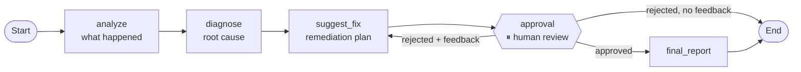
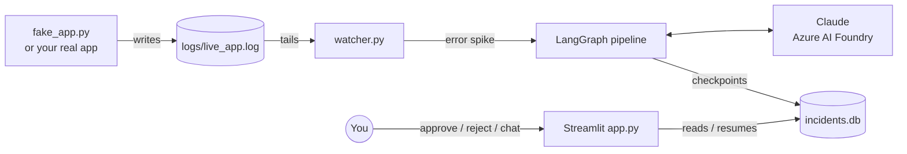

# 🔍 AI Incident Investigator

An AI-powered assistant that reads application logs, figures out **what happened**, finds the **root cause**, proposes a **fix**, waits for a **human to approve it**, and then writes an **incident report**.

It can work in two ways:

- **Live mode**: a watcher tails a running application's log file and automatically starts an investigation when errors spike.
- **Upload mode**: upload any `.log` / `.txt` file in the web UI and investigate it on demand.

The investigation pipeline is a [LangGraph](https://github.com/langchain-ai/langgraph) workflow powered by **Claude (via Azure AI Foundry)**, with a [Streamlit](https://streamlit.io/) front end. Each investigation also has a chat panel where you can ask follow-up questions about the logs.

---

## Table of contents

- [Features](#features)
- [How it works](#how-it-works)
- [Project structure](#project-structure)
- [Prerequisites](#prerequisites)
- [Setup](#setup)
- [Running the app](#running-the-app)
- [Command-line options](#command-line-options)
- [Log format](#log-format)
- [Quick terminal tests](#quick-terminal-tests)
- [Troubleshooting](#troubleshooting)

---

## Features

- **Smart log pre-processing**: parses each line into timestamp / level / service / message, keeps only errors and warnings (plus the 3 lines before each, where the cause usually is), and builds a compact summary so only relevant data is sent to the LLM.
- **Multi-step AI investigation**: `analyze → diagnose → suggest fix → human approval → final report`, with line-number citations like `(L13)` and a confidence level on the diagnosis.
- **Human-in-the-loop approval**: the graph pauses before acting. You can **approve**, **reject with feedback** (the AI revises the plan), or **reject without feedback** (the investigation stops).
- **Persistent, resumable state**: every investigation is checkpointed to SQLite (`incidents.db`), so the watcher can start an investigation and you can approve it later from the web UI, even after restarts.
- **Automatic error-spike detection**: the watcher triggers when N errors occur within a time window, with a cooldown to avoid duplicate incidents.
- **Fault simulator**: `fake_app.py` produces realistic traffic and injects one of several failure scenarios for demos and testing.
- **Chat about the logs**: ask questions such as *"Why did payments fail?"*, and Claude answers using only the log data and investigation results.
- **Downloadable Markdown incident report.**

---

## How it works

### Investigation graph



| Step | What it does |
|------|--------------|
| `analyze` | Describes affected services, when problems started, and a short timeline. |
| `diagnose` | Finds the most likely root cause, links cause to symptoms, cites log lines, and gives a confidence level. |
| `suggest_fix` | Proposes an immediate fix, a rollback option, and prevention steps. Uses reviewer feedback if a previous plan was rejected. |
| `approval` | Pauses the graph with LangGraph `interrupt()`. State is saved to SQLite until someone approves or rejects. |
| `final_report` | Writes a Markdown report: Summary, Timeline, Root Cause, Approved Fix, Prevention. |

### Live mode data flow



The watcher and the Streamlit app are separate processes that share `incidents.db` (SQLite in WAL mode), which is why an investigation started by the watcher can be approved in the browser.

---

## Project structure

```
Ai_incident_investigation_system/
├── .gitignore
├── README.md
└── log_investigator/
    ├── app.py               # Streamlit UI: live incidents, upload mode, approval, chat
    ├── graph.py             # LangGraph workflow, SQLite checkpointer, incident helpers
    ├── llm.py               # Claude client (Azure AI Foundry): ask_claude / chat_claude
    ├── log_parser.py        # Parses logs, filters important lines, builds the LLM input
    ├── watcher.py           # Tails logs/live_app.log and triggers on error spikes
    ├── fake_app.py          # Simulated app that writes logs and injects faults
    ├── requirements.txt     # Python dependencies
    ├── .env.example         # Template for credentials (copy to .env)
    ├── sample_logs/
    │   └── sample_app.log   # Example log (DB connection-pool incident)
    ├── logs/                # (generated, git-ignored) live_app.log
    └── incidents.db         # (generated, git-ignored) investigation state
```

---

## Prerequisites

- **Python 3.10+** (developed on Python 3.13)
- An **Azure AI Foundry** resource with a **Claude model deployment**, plus its API key and endpoint

---

## Setup

All commands are run from the `log_investigator/` folder, because the code uses paths relative to it (`incidents.db`, `logs/`, `sample_logs/`).

### 1. Clone and enter the project

```bash
git clone https://github.com/varshaHari27/Ai_incident_investigation_system.git
cd Ai_incident_investigation_system/log_investigator
```

### 2. Create and activate a virtual environment

```bash
python -m venv .venv
```

| OS / shell | Activate command |
|------------|------------------|
| Windows (PowerShell) | `.venv\Scripts\Activate.ps1` |
| Windows (cmd) | `.venv\Scripts\activate.bat` |
| macOS / Linux / Git Bash | `source .venv/bin/activate` |

### 3. Install dependencies

```bash
pip install -r requirements.txt
```

### 4. Configure credentials

Copy the template and fill in your values:

```bash
cp .env.example .env        # Windows PowerShell: Copy-Item .env.example .env
```

| Variable | Description |
|----------|-------------|
| `AZURE_ANTHROPIC_API_KEY` | API key for your Azure AI Foundry resource |
| `AZURE_ANTHROPIC_ENDPOINT` | Endpoint (base URL) of the Anthropic API on your Foundry resource |
| `AZURE_CLAUDE_DEPLOYMENT` | Name of your Claude model deployment |

> ⚠️ `.env` is git-ignored. Never commit real keys.

Check the connection:

```bash
python llm.py      # should print a one-line greeting from Claude
```

---

## Running the app

### Option A: Upload mode (simplest)

```bash
streamlit run app.py
```

1. Open the URL Streamlit prints (usually http://localhost:8501).
2. In the sidebar choose **📄 Upload a log**.
3. Upload `sample_logs/sample_app.log` and click **Run investigation**.
4. Review the analysis and root cause, then **Approve** or **Reject** the proposed fix.
5. Read and download the final incident report, and use the chat to ask follow-up questions.

### Option B: Live mode (full demo)

Open **three terminals**, each in `log_investigator/` with the virtual environment activated:

```bash
# Terminal 1: the web UI
streamlit run app.py

# Terminal 2: the watcher (start it before the fake app)
python watcher.py

# Terminal 3: the simulated application
python fake_app.py --fault db_pool --fault-after 30
```

After the fault starts, the watcher detects the error spike (10+ errors in 60s by default) and runs the investigation. In the UI, choose **🚨 Live incidents**, click **🔄 Refresh**, select the incident, and approve or reject the fix.

> 💡 For a faster demo, make the watcher more sensitive:
> `python watcher.py --threshold 5 --window 30`

To use a real application instead of `fake_app.py`, have it append logs (in the [format below](#log-format)) to `log_investigator/logs/live_app.log`.

---

## Command-line options

### `watcher.py`

| Option | Default | Description |
|--------|---------|-------------|
| `--threshold` | `10` | Number of errors needed to trigger an investigation |
| `--window` | `60` | Seconds over which errors are counted |
| `--context` | `180` | Seconds of recent logs sent to Claude |
| `--cooldown` | `300` | Seconds before the watcher can trigger again |
| `--interval` | `5` | Seconds between checks of the log file |
| `--from-start` | off | Also read lines already in the file (default: only new lines) |

### `fake_app.py`

| Option | Default | Description |
|--------|---------|-------------|
| `--fault` | `db_pool` | Scenario to inject: `db_pool`, `payment_api`, `memory_leak`, or `none` |
| `--fault-after` | `60` | Seconds of normal traffic before the fault starts |
| `--speed` | `1.0` | Seconds between log lines |

**Fault scenarios**

| Scenario | What it simulates |
|----------|-------------------|
| `db_pool` | A deploy shrinks the DB connection pool (20 → 5), causing connection timeouts, failed orders, and 500s |
| `payment_api` | The external payment gateway (PayGate) becomes slow and times out, causing failed checkouts and 504s |
| `memory_leak` | A new in-memory cache makes heap usage grow until `OutOfMemoryError` crashes and 503s |
| `none` | Normal traffic only (useful to confirm the watcher does **not** trigger) |

---

## Log format

The parser expects lines like:

```
2026-11-20 10:40:31 ERROR [order-service] Timeout acquiring DB connection after 5000ms
<timestamp>         <LEVEL> [<service>]   <message>
```

- **Timestamp**: `YYYY-MM-DD HH:MM:SS` (a `T` separator and trailing fractions/time zones are also accepted)
- **Level**: e.g. `INFO`, `WARN`, `ERROR`, `CRITICAL`, `FATAL`
- **Service**: optional, in square brackets
- Lines without a timestamp (such as stack traces) are attached to the previous entry.

A line is treated as **important** if its level is `ERROR`, `WARN`, `WARNING`, `CRITICAL`, or `FATAL`, **or** its message contains words like *error, exception, fail, timeout, refused, denied, crash*. Up to 300 important lines (with context) are sent to Claude.

---

## Quick terminal tests

Each module can be run directly for a quick check (from `log_investigator/`):

```bash
python llm.py          # test the Claude connection
python log_parser.py   # print the parsed summary of the sample log
python graph.py        # run a full investigation in the terminal with y/n approval
```

---

## Troubleshooting

| Problem | Fix |
|---------|-----|
| Authentication / 401 errors | Check the three values in `.env`, and make sure the file is in `log_investigator/` (next to `llm.py`). |
| `FileNotFoundError: sample_logs/...` | Run the scripts from inside `log_investigator/`. |
| "No incidents yet" in Live mode | Make sure `watcher.py` is running **before** the fault starts, lower `--threshold`, or use `--from-start`. Then click **🔄 Refresh**. |
| Incident stuck on "⏳ Investigating" | The watcher is still calling Claude. Wait a moment and refresh, and check the watcher terminal for errors. |
| `database is locked` | Make sure only one watcher is running. To start fresh, stop all processes and delete `incidents.db`, `incidents.db-shm`, and `incidents.db-wal`. |

---

## Tech stack

- **[LangGraph](https://github.com/langchain-ai/langgraph)**: workflow orchestration, `interrupt()` for human approval, `SqliteSaver` checkpointing
- **[Anthropic Python SDK](https://github.com/anthropics/anthropic-sdk-python)**: Claude via Azure AI Foundry (`AnthropicFoundry`)
- **[Streamlit](https://streamlit.io/)**: web UI
- **SQLite**: shared, persistent investigation state
- **python-dotenv**: configuration from `.env`
